# Dr.250

**A patient, doctor, and administrator healthcare workflow application.** Dr.250 brings patient-controlled history, doctor discovery and appointments, consultation records, prescriptions, and doctor verification into one role-aware web application. The [public demonstration site](https://dr250-frontend-hi-9b5d.vercel.app/) uses fictional accounts and synthetic records only.

> **University demonstration:** Doctor identities in the demo are explicitly marked “DEMO ONLY - NOT A REAL CLINICIAN.” The site is not a clinical service. Do not enter real patient information.

## Problem statement and objectives

Health history, appointment booking, clinician access, and prescriptions are often separated across systems. Dr.250 explores a single workflow in which Patients can see their records and control access, Doctors can consult only with appropriate verification and consent, and an Admin can review Doctor applications. Its objectives are to make these role boundaries visible, keep decisions auditable, and provide a usable bilingual interface.

## Main features

| Role | Available workflows |
| --- | --- |
| Patient | Register, report a basic health profile, set country, find an available verified Doctor, book a same-day chamber visit, request care, view records and prescriptions, manage Doctor access, and inspect completed visits. |
| Doctor | Register for review, complete a professional profile, set chamber timezone and daily availability, manage today's queue, accept a care request, read authorized history, write a prescription, and complete a consultation. |
| Admin | Review pending Doctor applications, approve or reject them, and inspect reviewed decisions. Admin accounts cannot self-register. |

English and Bangla are available in the interface. The current deployment includes four new fictional Patient accounts and four new fictional Doctor accounts; two additional synthetic accounts from earlier production testing were preserved. Among the four new Doctors, two are VERIFIED, one is PENDING, and one is REJECTED. No demo credentials are published here.

## Technology stack and system architecture

| Layer | Technology |
| --- | --- |
| Frontend | React 19, React Router 7, Vite 8, Tailwind CSS |
| Backend | Node.js 22, Express 5, PostgreSQL client, Docker |
| Database | PostgreSQL 16, forward-only SQL migrations |
| Hosting | Vercel static frontend, Render Docker web service, Render managed PostgreSQL |
| Local development | npm and Docker Compose |

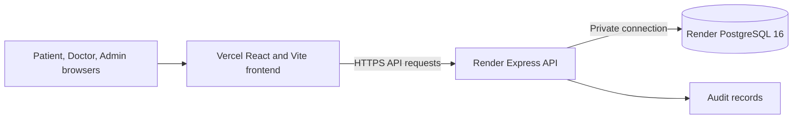

The frontend is built from `apps/frontend`; the Render Docker image uses the repository root as its build context and `apps/backend/Dockerfile`. The API runs the migration chain before listening. The production frontend is [dr250-frontend-hi-9b5d.vercel.app](https://dr250-frontend-hi-9b5d.vercel.app/), and the API is [dr250-demo-api.onrender.com](https://dr250-demo-api.onrender.com/api/health).

## Application workflow

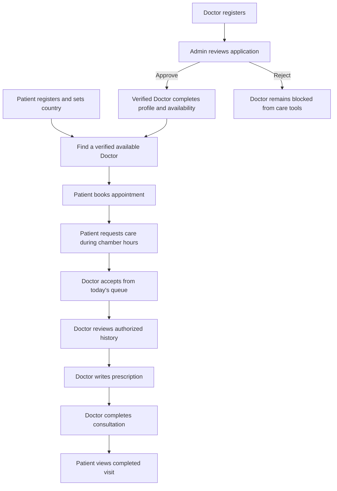

Booking follows the Doctor's chamber date, timezone, booking window, and capacity. A booking alone does not grant access to records. A Doctor can open consultation history only while an active care session authorizes it; completing the visit closes that temporary access. Patients can also grant and revoke Doctor access separately.

### Patient consent and Doctor access

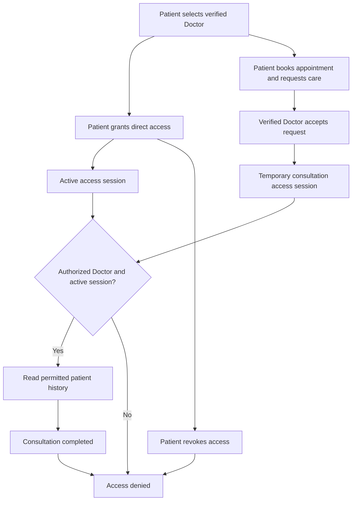

Direct grants and consultation access are separate paths. The API checks the Doctor, Patient, and session state on protected reads; revocation or consultation completion ends the corresponding access.

## Authentication and authorization

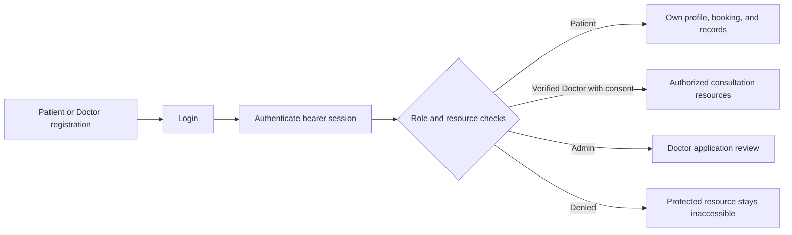

New local accounts use salted `scrypt` password hashes in the private database schema. Random bearer sessions are stored as hashes in PostgreSQL and expire after 24 hours. The browser keeps the token in session storage or, when requested, local storage. Legacy Supabase authentication remains optional for pre-existing accounts; the fresh demo uses local accounts. Login and registration have shared PostgreSQL rate limits. Public registration permits Patient and Doctor roles only; production Admin provisioning is a one-time private CLI operation.

Protected routes enforce the authenticated role, resource ownership, Doctor verification, and active Patient authorization. Doctor verification changes and provider reads are audited. The backend uses HTTPS hosting, Helmet, a request size limit, and an exact frontend CORS origin. See [deployment notes](docs/deployment.md) for security and operational details.

## Database design

`database/migrations` is the active forward-only schema history; `dr250_meta.schema_migrations` records applied files and checksums. The current chain ends at `023_auth_security.sql`; `database/policies.sql` is also applied. Core entities include users and profiles, Patients and Doctors, medical records, prescriptions, appointments, access sessions, audit logs, and private authentication tables. Consultation state belongs to appointments. Migration 022 adds booking windows and the patient-reported `Unknown` blood group. Migration 023 adds rate-limit counters and the one-time Admin bootstrap marker.

The ER diagram shows the active care and authentication tables. Consultation state is stored on `appointments`; it is not a separate consultations table.

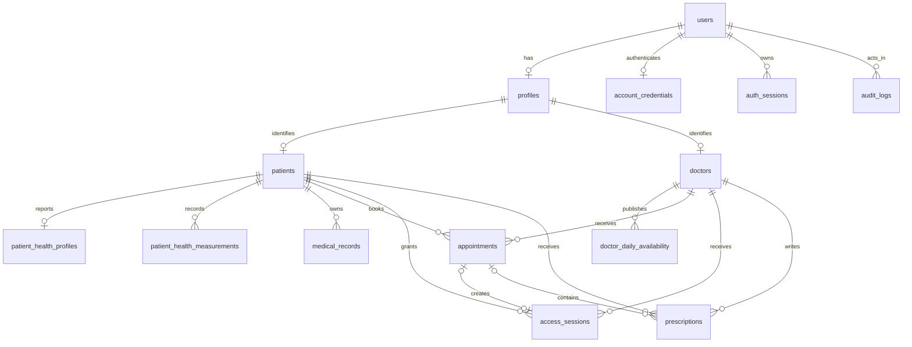

Historical migrations that are not used for a fresh install remain in `database/retired-migrations`. Earlier lab and access-session columns are retained for compatibility; the current interface does not expose laboratory or QR/PIN workflows. See [database/README.md](database/README.md) for migration and disposable test database guidance. Never restore local or real patient data into the public demonstration database.

## Live application screenshots

These images were captured from the deployed application on **12 November 2026** using fictional accounts. Sidebar account IDs and numeric license fields are excluded or masked; no credentials appear.

| Public entry | Patient workspace |
| --- | --- |
| 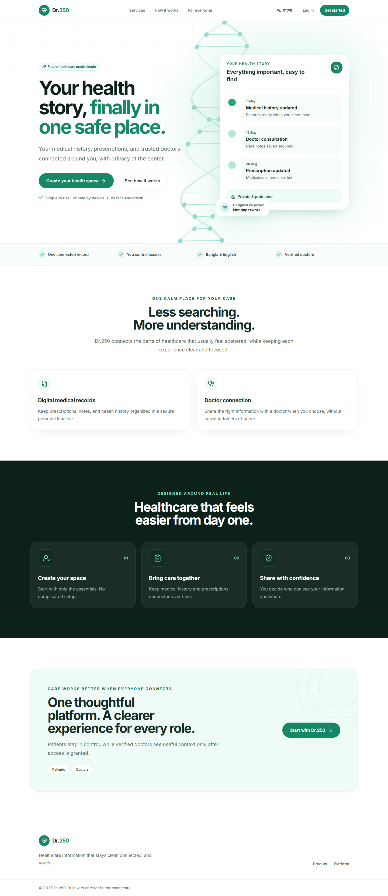<br>Public landing page | 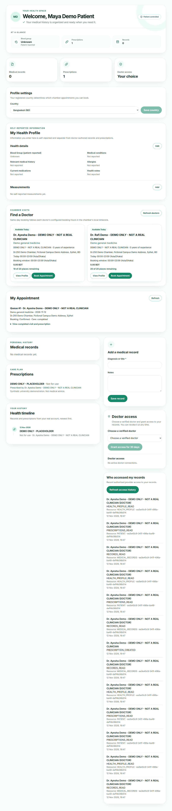<br>Patient dashboard |
| 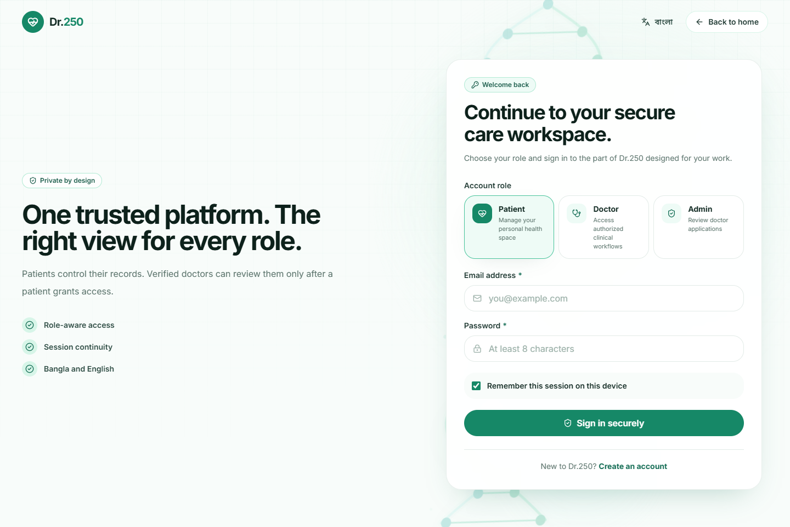<br>Role-aware login | 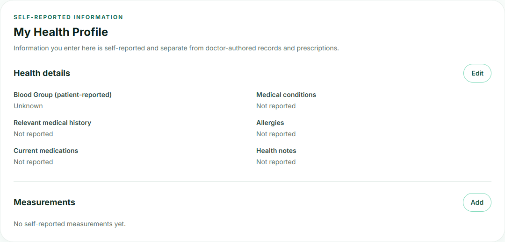<br>Patient health profile |
| 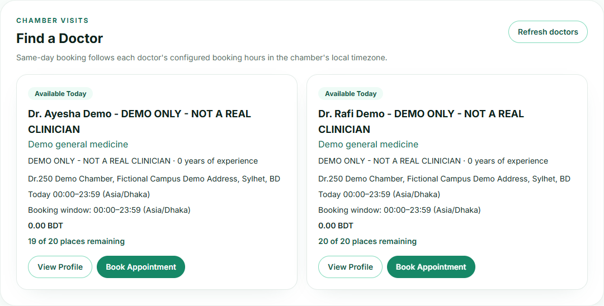<br>Find a Doctor | 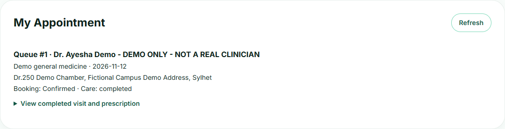<br>Patient appointment |

| Doctor workspace | Admin review |
| --- | --- |
| 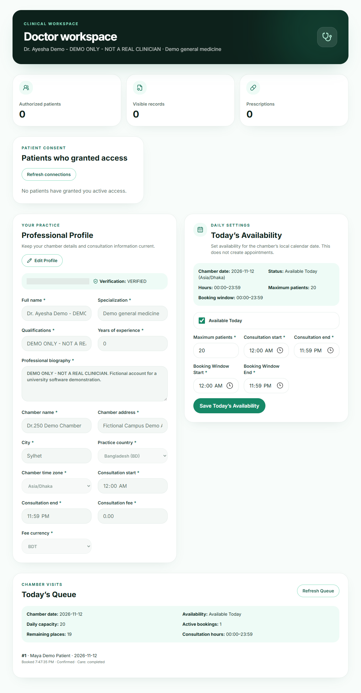<br>Doctor dashboard | 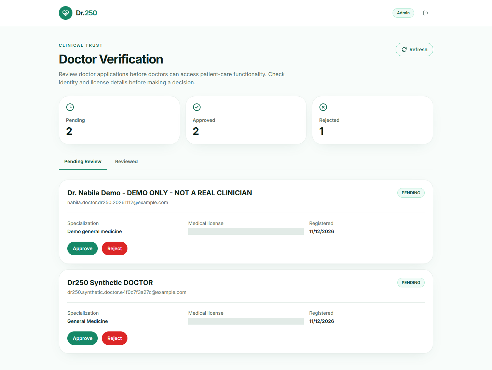<br>Pending applications |
| 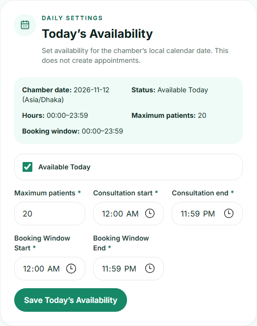<br>Doctor availability | 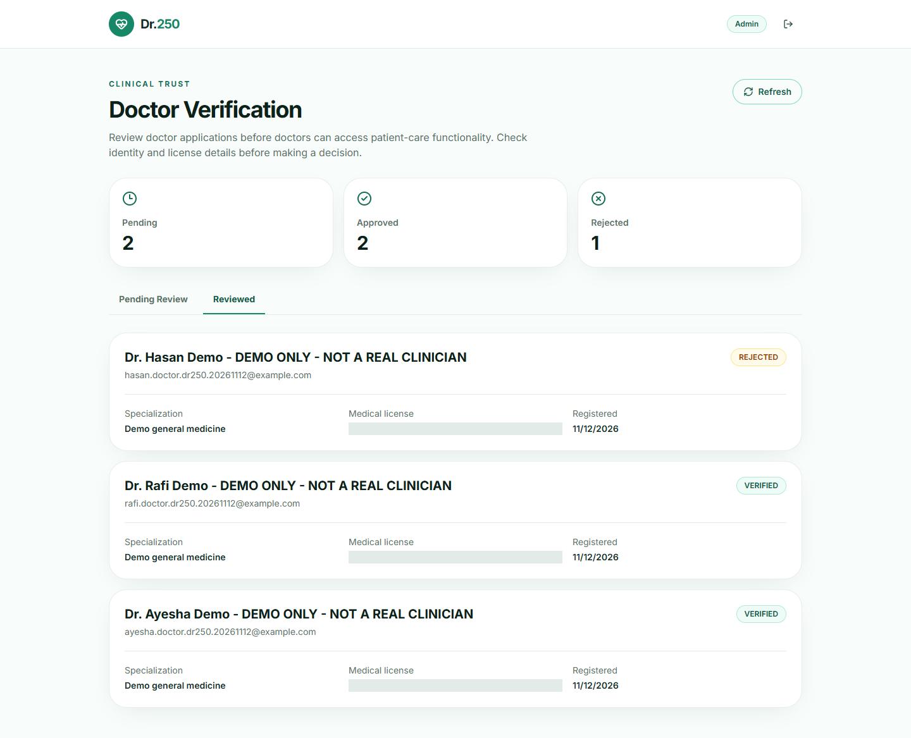<br>Reviewed applications |
| 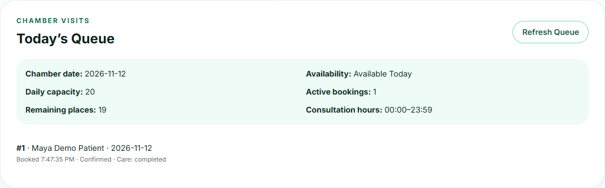<br>Today's queue | 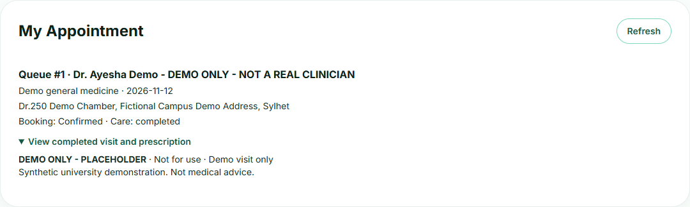<br>Completed visit |

Earlier local-release screenshots remain available for technical comparison: [Patient dashboard](docs/screenshots/patient-dashboard.jpg), [Doctor dashboard](docs/screenshots/doctor-dashboard.jpg), [medical history](docs/screenshots/medical-history.jpg), [Doctor access](docs/screenshots/doctor-access.png), [prescriptions](docs/screenshots/prescriptions.jpg), [appointment](docs/screenshots/patient-appointment.png), [queue](docs/screenshots/doctor-todays-queue.png), [Admin review](docs/screenshots/admin-verification.png), and [completed visit](docs/screenshots/patient-completed-visit.png). These show fictional details in a disposable local database.

## Installation and environment

Use Node.js 24 for the frontend, Node.js 22 for the backend, PostgreSQL 16, and npm. Copy `.env.example` to `.env` for local development and keep it private. The backend needs a reachable local PostgreSQL URL; never point a local development process or test at production.

| Variable | Purpose |
| --- | --- |
| `DATABASE_URL`, `DATABASE_SSL` | PostgreSQL connection and TLS choice |
| `PORT`, `CORS_ORIGIN`, `TRUST_PROXY_HOPS` | API listener, allowed frontend origin, trusted proxy count |
| `VITE_API_URL` | Frontend build-time public HTTPS API origin |
| `POSTGRES_DB`, `POSTGRES_USER`, `POSTGRES_PASSWORD`, `POSTGRES_PORT` | Local Docker PostgreSQL |
| `BACKEND_PORT`, `FRONTEND_PORT` | Local Docker published ports |
| `SUPABASE_URL`, `SUPABASE_ANON_KEY`, `SUPABASE_SERVICE_ROLE_KEY` | Optional legacy authentication |
| `AUTH_INTEGRATION_URL`, `DR250_DISPOSABLE_URL` | Test-only loopback `dr250_release_*` database URLs |

```bash
# Terminal 1
cd apps/backend
npm ci
npm run db:migrate
npm run dev

# Terminal 2
cd apps/frontend
npm ci
npm run dev
```

Open `http://localhost:5173`. Alternatively, configure `.env` and run `docker compose up --build` from the repository root. Compose starts local PostgreSQL and runs backend migrations. Do not recreate an existing populated database to apply upgrades.

## Testing and deployment

Run backend syntax and isolated tests without production database access:

```bash
cd apps/backend
npm run check
npm run test:isolated

cd ../frontend
npm test
npm run lint
npm run build
```

For the full migration and database integration suite, use a migrated disposable PostgreSQL 16 database on loopback named `dr250_release_*` with `AUTH_INTEGRATION_URL` and `DR250_DISPOSABLE_URL` pointing to it. The historical restore fixture also needs pgvector; the fresh production database does not.

| Evidence | Result |
| --- | --- |
| Previous disposable database run, 11 November 2026 | Backend 79/79 passed with no skips; frontend 15/15 passed; lint and production build passed. |
| Current isolated backend run, 13 November 2026 | Syntax check passed for 71 files; 71 tests passed, 8 database integration tests skipped, 0 failed. Docker was unavailable, so the database integration suite was not repeated. |
| Current frontend run, 13 November 2026 | 15 tests passed, 0 failed; ESLint and Vite production build passed. |
| Current public deployment check, 13 November 2026 | HTTP 200 from both API health endpoints and direct frontend routes `/`, `/login`, `/patient`, `/doctor`, and `/admin`; API response allowed the exact production frontend CORS origin. |

The current public check was read-only. It did not repeat authenticated browser workflows or change production records.

Previously completed browser testing exercised Patient and Doctor login, Admin login and review, Doctor verification decisions, Doctor discovery, booking, Request Care, acceptance, authorized history, a clearly marked placeholder prescription, consultation completion, and the Patient's completed-visit view. The static frontend uses a Vercel SPA rewrite so direct role routes load.

The deployment uses a free Render web service and a free PostgreSQL 16 instance in Singapore, linked by Render's private database URL. The frontend uses a provider-generated Vercel URL. The free database expires after 30 days from creation and has no managed backup; this setup is for a temporary synthetic demonstration. The runtime database role currently owns migrations, so the application is not intended for real patient data. The [deployment notes](docs/deployment.md) retain the detailed preparation, migration, and operational guidance.

## Project structure

- `apps/frontend/src/app` and `apps/frontend/src/portals`: routing and role workspaces.
- `apps/frontend/src/services`: API and session clients.
- `apps/backend/src/modules`: authentication, appointments, consultations, Patients, Doctors, Admin, records, prescriptions, and audit logic.
- `apps/backend/scripts`: migration runner and private production Admin provisioning CLI.
- `database/migrations`: active SQL schema history.
- `database/retired-migrations`: preserved historical migration files.
- `docs/screenshots`: captured local-release and deployed-site views.

## Future scope

For any use beyond a short fictional demonstration, plan durable database backups, separate migration and runtime database roles, a reviewed account recovery process, and clinical/privacy review before real patient information is considered. No additional features are needed for the university demonstration.
