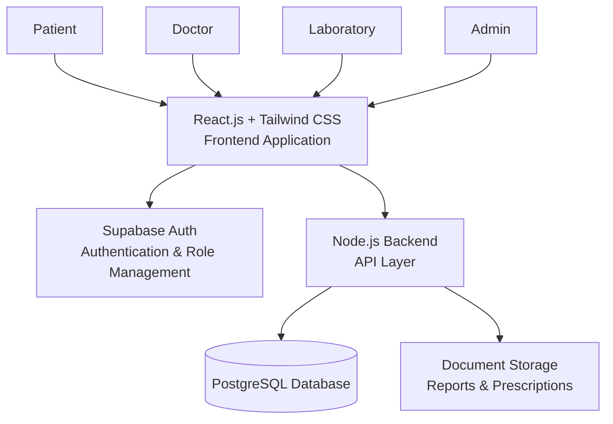
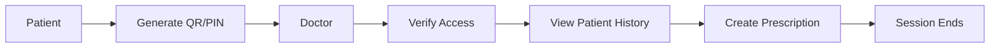
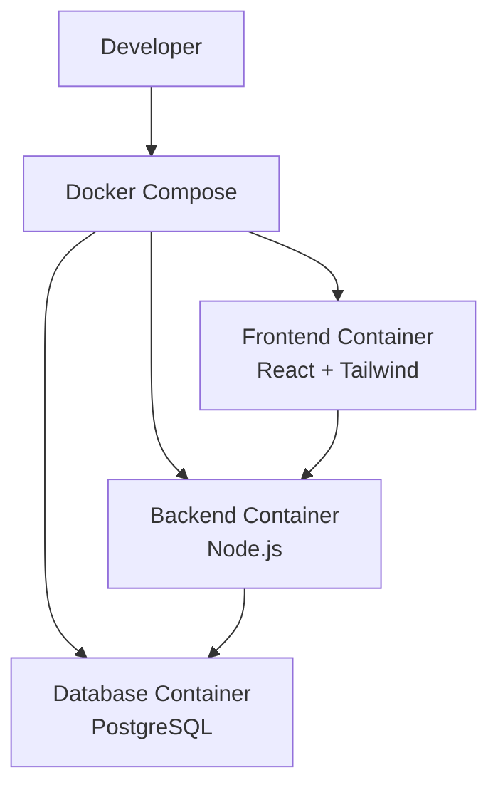
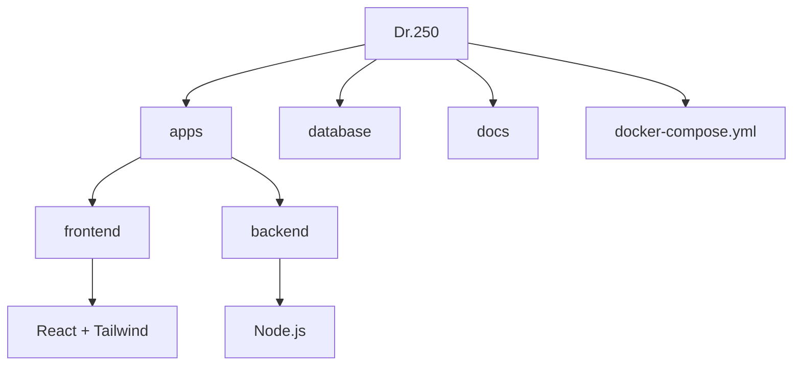

# Dr.250 🏥

## A Smart Digital Healthcare Ecosystem


---

# Team: BioByte

## Team Members

| Name | ID |
|---|---|
| Riddhi Das | 2023331004 |
| Mustari Ifthe | 2023331050 |

---

# Project Overview

**Dr.250** is a smart healthcare platform designed to connect **patients, doctors, and laboratories** through a secure digital healthcare ecosystem.

The project focuses on solving the problem of fragmented healthcare information. Patients often store prescriptions, medical reports, and diagnostic results across different hospitals and clinics, making it difficult to maintain a complete medical history.

Dr.250 provides a unified healthcare record platform where:

- Patients can securely manage their health information.
- Doctors can access authorized medical histories.
- Laboratories can directly provide digital reports.

---

# Vision

To create a simple, secure, and accessible healthcare platform where medical information becomes:

- Organized
- Connected
- Patient-controlled
- Easily accessible
- Privacy-focused

---

# Objectives

- Develop a centralized digital healthcare record system.
- Reduce dependency on physical medical documents.
- Improve communication between patients, doctors, and laboratories.
- Ensure secure access and privacy of medical data.

---

# System Architecture



---

# Problem Statement

Healthcare information is often scattered across:

- Different healthcare providers
- Diagnostic centers
- Paper-based reports
- Separate digital systems

This creates challenges such as:

- Doctors not having complete patient history.
- Patients carrying multiple physical documents.
- Difficulty tracking previous prescriptions and reports.
- Lack of efficient communication between healthcare providers.

---

# Proposed Solution

Dr.250 introduces an integrated healthcare ecosystem consisting of:

1. Patient Portal
2. Doctor Portal
3. Laboratory Portal

The platform allows patients to maintain ownership of their health records while enabling secure collaboration with healthcare professionals.

---

# Core Features

## 1. Personal Health Record Management

Patients can:

- Create personal healthcare profiles.
- Store medical reports and prescriptions.
- Maintain laboratory history.
- View complete medical timelines.

The patient's information remains private unless access is granted through the platform.

---

# 2. QR/PIN Based Secure Patient Access

Dr.250 introduces a temporary access mechanism for doctors.

Workflow:



Benefits:

- Prevents incorrect patient identification.
- Provides controlled access.
- Improves privacy and security.

---

# 3. Doctor Portal

Doctors can:

- View authorized patient records.
- Review previous reports and prescriptions.
- Understand patient history before consultation.
- Create structured digital prescriptions.
- Request laboratory tests.

---

# 4. Laboratory Portal

Laboratories can:

- Receive digital test requests.
- Update test progress.
- Upload completed reports.
- Deliver reports directly to patient records.

---

# Security & Privacy

Dr.250 focuses on:

- Secure authentication.
- Role-based access control.
- Patient-controlled data sharing.
- Protected medical documents.
- Access transparency.

User roles:

```
Patient
Doctor
Laboratory
Admin
```

---

# Technology Stack

| Layer | Technology |
|---|---|
| Frontend | React.js + Tailwind CSS |
| Backend | Node.js |
| Database | PostgreSQL |
| Authentication | Supabase Auth |
| Development Environment | Docker + Docker Compose |
| Deployment | Vercel + Docker |

---

# Docker Architecture



---

# Project Structure



---

Detailed structure:

```
Dr.250/

├── apps/
│
│── frontend/
│   ├── src/
│   └── Dockerfile
│
│── backend/
│   ├── src/
│   └── Dockerfile
│
├── database/
│   ├── migrations/
│   ├── schema.sql
│   └── policies.sql
│
├── docs/
│
├── packages/
│
├── docker-compose.yml
├── .env.example
└── README.md
```

---

# Local Development Setup

## Requirements

Install:

- Git
- Node.js
- Docker Desktop


---

## Clone Repository

```bash
git clone <repository-url>

cd Dr.250
```

---

## Environment Configuration

Create:

```
.env
```

Example:

```env
DATABASE_URL=
SUPABASE_URL=
SUPABASE_KEY=
```

---

# Running With Docker

Build containers:

```bash
docker compose build
```

Start application:

```bash
docker compose up
```

Stop application:

```bash
docker compose down
```

---

# Deployment

## Frontend

Platform:

```
Vercel
```

---

## Backend

Deployment:

```
Docker-based deployment
```

---

## Database

Technology:

```
PostgreSQL
```

---

# Development Roadmap

## Phase 1 — Foundation

- Project initialization.
- Docker configuration.
- Database design.
- Authentication setup.


## Phase 2 — Healthcare Platform

- Patient portal.
- Doctor portal.
- Laboratory portal.
- Medical record management.


## Phase 3 — Testing & Deployment

- Security testing.
- Performance optimization.
- Final deployment.

---

# Future Scope

Future improvements may include:

- Mobile application.
- Healthcare provider integration.
- SMS-based healthcare access.
- Remote healthcare assistance.

---

# Disclaimer

Dr.250 is an academic software project.

It is not a certified medical record system and does not replace professional medical advice.


---

# Developed By

## Team BioByte

Dr.250 — A Smart Digital Healthcare Ecosystem